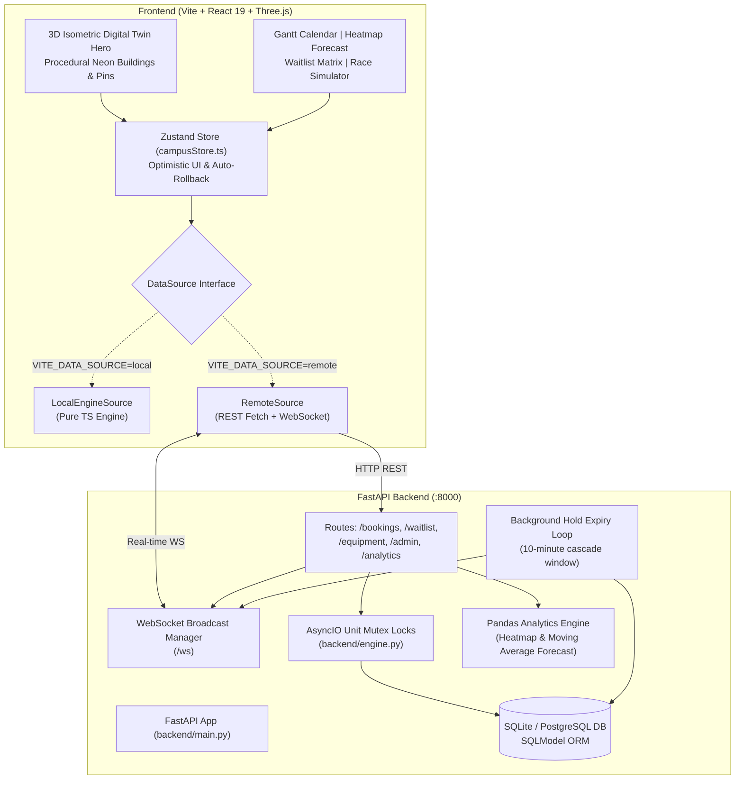

# ZeroClash 🚀
### Smart Campus Shared Equipment Booking & Real-Time Conflict Resolution Hub


**ZeroClash** is a production-grade campus resource management system and 3D digital twin interface designed to eliminate reservation clashes, ghost bookings, and idle equipment across university research labs, media studios, and engineering departments.

Built for **Team GALACTICOS** — **Problem Statement 7: Shared Equipment Booking & Conflict Management**.

---

## ⚡ Quick Start (One Command)

### 1. Prerequisites
- **Node.js** (v18.x or later)
- **Python** (v3.10+ recommended)

### 2. Install & Launch Everything Together
```bash
# Clone repository
git clone https://github.com/Awwad-007/ZeroClash.git
cd ZeroClash

# Install Frontend dependencies
npm install

# Install Backend dependencies
pip install -r backend/requirements.txt   # or: pip install fastapi uvicorn sqlmodel pandas httpx pytest-asyncio websockets

# Seed the database (first run)
python backend/seed.py

# Run both Vite frontend and FastAPI backend concurrently with colored logs
npm run dev:all
```
- **Web App**: [http://localhost:5173](http://localhost:5173)
- **FastAPI Backend Swagger Docs**: [http://localhost:8000/docs](http://localhost:8000/docs)
- **WebSocket Feed**: `ws://localhost:8000/ws`

### 3. Run Automated Tests
```bash
# Run both Vitest (15 unit tests) & Pytest (4 backend concurrency tests)
npm run test:all

# Or run separately:
npm test           # Frontend Conflict Engine & Waitlist Cascade (15 tests)
npm run test:backend # FastAPI Concurrency, Race Condition & SQLite tests (4 tests)
```

---

## 🏛️ System Architecture

ZeroClash uses a modular architecture with an abstracted **DataSource** contract, enabling seamless switching between an **in-memory pure TypeScript simulation engine** (`LocalEngineSource`) and a **concurrency-locked FastAPI + SQLModel backend** (`RemoteSource`).



---

## ⚙️ Conflict Resolution & Waitlist Algorithm

### 1. Strict Interval Overlap Detection
Two intervals $[A_{\text{start}}, A_{\text{end}}]$ and $[B_{\text{start}}, B_{\text{end}}]$ clash on the same equipment unit if and only if:
$$\text{hasOverlap}(A, B) \iff A_{\text{start}} < B_{\text{end}} \quad \land \quad A_{\text{end}} > B_{\text{start}}$$

- **Back-to-back reservations do NOT clash**: If Booking A ends at 11:00 and Booking B starts at 11:00, $A_{\text{end}} = B_{\text{start}}$, which evaluates to `false`.
- When a conflict is detected, ZeroClash returns `HTTP 409 Conflict` along with automated smart alternative slots.

### 2. Concurrency Control & Race Condition Prevention
During high-demand checkout rushes (e.g. 5 students booking a GPU cluster at 9:00:00 AM):
- **Frontend**: Optimistic booking with atomic rollback and instant 409 error toast if another user claims the slot first.
- **Backend**: In-memory unit-level asyncio locks (`get_unit_lock(unit_id)`) serialize simultaneous database queries, guaranteeing strict ACID serializability without deadlocks.

### 3. Priority Waitlist Scoring Formula
When a slot is booked, subsequent users enter a priority queue ranked by:
$$\text{Priority Score} = (\text{Role Score} \times 0.40) + (\text{Urgency Score} \times 0.40) + (\text{Reliability Score} \times 0.20)$$

| Dimension | Weights / Values |
| :--- | :--- |
| **Role Weight (40%)** | Faculty = 40 pts, Researcher = 35 pts, Lab Admin = 30 pts, Student = 20 pts |
| **Urgency Weight (40%)** | High = 40 pts, Medium = 25 pts, Low = 10 pts |
| **Reliability Score (20%)** | $\max(0, 100 - \text{noShowCount} \times 20) \times 0.20$ |

### 4. Automated 10-Minute Provisional Hold Cascade
Upon cancellation of an active booking:
1. The queue automatically selects the highest-scoring candidate.
2. A **10-minute provisional hold** (`HoldEntry`) is awarded to the user.
3. Real-time WebSocket notifications alert the user.
4. If unconfirmed within 10 minutes, the hold expires automatically, and the engine cascades to the next eligible waitlisted candidate.

---

## 🎬 3-Minute Walkthrough Demo Script

### Minute 1: 3D Twin Discovery & Real-Time Conflict Detection
1. **Explore Campus**:
   - Open [http://localhost:5173](http://localhost:5173). Notice the 3D isometric cyberpunk campus with edge-glowing buildings and bobbing teardrop pins.
   - Use the top search bar: type `"Camera"` or `"Science"`. The camera automatically frames the target building while non-matching pins dim.
2. **Trigger Instant Conflict Validation**:
   - Click on **DSLR Camera #04** in Media Lab (NE).
   - In the slide-out booking panel, choose a slot that overlaps with an existing booking (e.g. 10:00 AM – 1:00 PM).
   - Notice the **live warning banner** and the **Suggested Alternative Slots** chips.
   - Click an alternative chip to auto-fill a non-conflicting interval.

### Minute 2: Priority Waitlist Queue & Cascade
1. **Join the Waitlist**:
   - Switch persona to **Dr. Elena Vance (Faculty)** using the top-right persona switcher.
   - Click **"Join Priority Waitlist"** for an occupied unit. Select **High Urgency**.
   - Dr. Elena receives a top score (e.g., 96/100) and appears at the top of the waitlist table.
2. **Execute Cancellation & Trigger Hold Cascade**:
   - Open the **My Bookings Drawer** (click the ticket button in top-right).
   - Click **"Cancel Reservation"** on an active booking.
   - Observe the instant toast: the slot is vacated and a **10-minute provisional hold** is automatically awarded to Dr. Elena!
   - Click **"Confirm Hold"** to convert the provisional hold into a confirmed booking.

### Minute 3: Hardware Maintenance & Race Condition Simulation
1. **Emergency Maintenance Lockout**:
   - Scroll down to the **Admin Override & Telemetry** section.
   - Click **"Lockout / Maintenance"** on **3D Printer #01**.
   - Notice that conflicting upcoming reservations are automatically cancelled with an audit log record, and the unit turns red (`MAINTENANCE`).
2. **Run Concurrency Race Condition Simulator**:
   - In the Admin section, find the **Simultaneous Concurrency Simulator** widget.
   - Click **"Simulate 5 Simultaneous Bookers"**.
   - Watch the live telemetry bar: exactly **1 user wins the lock** (`200 OK`), and the remaining **4 users receive clean `409 Conflict`** rejections with alternative options. Zero duplicate bookings!

---

## 🧪 Test Coverage Breakdown

### Frontend Engine (Vitest — 15 Tests)
- `hasOverlap`: Strict overlap bounds and back-to-back non-clash validation.
- `checkAvailability`: Conflict detection with active bookings and maintenance windows.
- `calculatePriorityScore`: Role, urgency, and reliability score calculations.
- `BookingEngine.createBooking`: Concurrency lock serialization under race conditions.
- `BookingEngine.cancelBooking`: Instant 10-minute hold cascade to top waitlist entry.
- `BookingEngine.modifyBooking`: Atomic reschedule with rollback on clash.
- `BookingEngine.setMaintenance`: Auto-cancellation of future reservations.
- `deriveUnitStatus`: Real-time timestamp-based status derivation (available / in use / maintenance).

### Backend FastAPI (Pytest — 4 Tests)
- `test_race_condition_simultaneous_booking`: 5 concurrent `asyncio.gather` requests fighting for one unit; exactly 1 succeeds and 4 receive 409 Conflict.
- `test_back_to_back_slots_not_a_clash`: Adjacent intervals $[10:00, 11:00]$ and $[11:00, 12:00]$ both succeed without clash.
- `test_cancel_then_waitlist_cascade_and_confirm`: Slot cancellation activates provisional hold, followed by `/holds/{id}/confirm`.
- `test_maintenance_auto_cancels_future_bookings`: Administrative maintenance locks out the unit and cleans conflicting reservations.

---

## 📦 Project Structure

```
ZeroClash/
├── backend/                        # FastAPI Backend
│   ├── routes/
│   │   ├── admin.py                # Maintenance lockouts & audit logs
│   │   ├── analytics.py            # Pandas heatmap & forecast endpoints
│   │   ├── bookings.py             # Atomic booking creation, modify & cancel
│   │   ├── equipment.py            # Equipment catalog & availability check
│   │   └── waitlist.py             # Priority scoring & hold confirmation
│   ├── tests/
│   │   └── test_backend.py         # Pytest concurrency & race condition suite
│   ├── config.py                   # App config & CORS
│   ├── database.py                 # SQLModel SQLite / PostgreSQL engine
│   ├── engine.py                   # Concurrency locks, waitlist scoring & cascade
│   ├── main.py                     # FastAPI app, lifespan background hold loop & WS
│   ├── models.py                   # SQLModel domain models
│   ├── seed.py                     # Seed database generator
│   └── websocket_manager.py        # Real-time WebSocket connection manager
├── src/
│   ├── api/                        # DataSource abstraction
│   │   ├── dataSource.ts           # DataSource interface & contract
│   │   ├── LocalEngineSource.ts    # In-memory TypeScript engine implementation
│   │   ├── RemoteSource.ts         # REST + WebSocket client with auto-reconnect
│   │   └── index.ts                # Environment switcher & singletons
│   ├── components/                 # React UI Suite
│   │   ├── AdminMaintenanceSection.tsx  # Hardware lockout & race simulator
│   │   ├── AnalyticsSection.tsx          # Mini-nav sticky bar
│   │   ├── EquipmentModal.tsx            # Slide-out booking panel & conflict chips
│   │   ├── GanttSection.tsx              # 24h interactive Gantt calendar
│   │   ├── HeatmapForecastSection.tsx    # 7x24 heatmap & SVG demand forecast
│   │   ├── MyBookingsDrawer.tsx          # Manage reservations & holds
│   │   ├── SciFiHeader.tsx               # Header with Live/Offline Connection Health Pill
│   │   ├── SearchBar.tsx                 # Fuzzy equipment & building search
│   │   ├── StatusLegend.tsx              # Availability legend
│   │   ├── ToastContainer.tsx            # Animated notification alerts
│   │   ├── UserSwitcher.tsx              # 4 demo personas (Student/Faculty/etc)
│   │   └── ViewportControls.tsx          # Camera zoom & wireframe toggles
│   ├── engine/                     # Pure TypeScript Conflict Engine
│   │   ├── bookingEngine.ts        # Concurrency locks, modify rollback & status derivation
│   │   ├── conflict.ts             # Interval overlap & availability logic
│   │   ├── waitlist.ts             # Scoring formula & 10-minute hold cascade
│   │   └── __tests__/              # 15 Vitest unit tests
│   ├── scene/                      # Three.js / R3F 3D Digital Twin
│   │   ├── BuildingMesh.tsx        # Individual procedural architecture meshes
│   │   ├── CameraController.tsx    # Smooth damping & search lerp
│   │   ├── CampusBuildings.tsx     # 7 procedural campus buildings
│   │   ├── CampusCanvas.tsx        # R3F Canvas & post-processing bloom
│   │   ├── CampusGround.tsx        # Isometric grid & courtyard paths
│   │   └── EquipmentPins.tsx       # Floating teardrop pins with badge icons
│   ├── store/
│   │   └── campusStore.ts          # Zustand store with optimistic UI & rollback
│   ├── types/
│   │   └── index.ts                # Domain types & schemas
│   ├── App.tsx                     # Main layout
│   └── main.tsx                    # React entrypoint
├── package.json                    # Scripts: dev, server, dev:all, test, test:all, build
└── README.md
```

---

## 🏆 Problem Statement 7 Checklist

- [x] **Comprehensive Equipment Catalog**: 8 units mapped across 5 campus buildings with unit numbers, specs, and icons.
- [x] **Real-Time Interval Conflict Detection**: Instant validation preventing overlapping reservations; back-to-back allowed.
- [x] **Concurrency & Race Condition Handling**: Mutex locks on both frontend engine and backend FastAPI preventing double-bookings.
- [x] **Priority Waitlist with Scored Allocation**: Role (40%) + Urgency (40%) + Reliability (20%) scoring algorithm.
- [x] **10-Minute Provisional Hold Cascade**: Background loop and cancellation triggers provision hold to top candidate with auto-expiry.
- [x] **Administrative Hardware Lockout**: Maintenance toggle auto-cancelling conflicting future bookings with audit logs.
- [x] **Predictive Heatmap & Moving Average Forecast**: 7x24 facility usage matrix with moving-average demand line chart.
- [x] **Full-Featured 3D Isometric Digital Twin**: Cyberpunk dark mode campus with floating status pins, search framing, and camera damping.
- [x] **Automated Test Suites**: 15 Vitest tests + 4 Pytest backend concurrency tests.

---

## 🛡️ License
MIT License. Created by Team GALACTICOS for Problem Statement 7.
